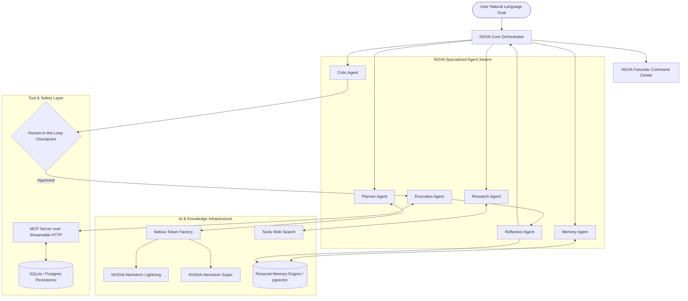

# NOVA 2.0 – Architecture & System Design

**Product Name:** NOVA  
**Full Name:** NOVA – Personal AI Operating System  
**Tagline:** *Think. Remember. Orchestrate. Execute.*  
**Target:** Nebius x NVIDIA Global AI Hackathon 2026

---

## 1. System Architecture Overview

---

## 2. Core Architectural Subsystems

### A. Nebius Token Factory & NVIDIA Nemotron Client (`backend/app/core/nebius_client.py`)
- Provides an OpenAI-compatible REST client to Nebius Token Factory.
- Implements dynamic model routing:
  - **`NEBIUS_MODEL_LIGHTNING` (`nvidia/nemotron-mini-4b-instruct`)**: Routine reasoning, validation, and critic analysis.
  - **`NEBIUS_MODEL_SUPER` (`nvidia/llama-3.1-nemotron-70b-instruct`)**: Complex goal decomposition, multi-step orchestration, and strategic planning.
- Tracks prompt/completion token usage and per-call latency in milliseconds.
- Features exponential backoff, retry mechanisms, and deterministic simulation fallback for zero-downtime offline execution and CI testing.

### B. Personal Memory Engine (`backend/app/services/memory_service.py`)
- Stores persistent context across 7 categories:
  1. Profile & Preferences
  2. Decisions & Operating Rules
  3. Active Projects & Hackathon Goals
  4. Pending Commitments
  5. Learned Behavioral Patterns
  6. Historical Workflow Records
  7. Conversations
- Supports semantic similarity retrieval using normalized dense embeddings (cosine distance).
- Performs automatic deduplication and updates rather than blind insertions.

### C. Specialized Multi-Agent System (`backend/app/agents/`)
- **Planner Agent**: Synthesizes personal context and user prompts into an ordered dependency plan.
- **Research Agent**: Queries live web sources via Tavily, extracts evidence snippets, and preserves source URLs.
- **Memory Agent**: Semantically retrieves personal context before execution and updates memory after execution.
- **Execution Agent**: Invokes verified Model Context Protocol (MCP) tools.
- **Critic Agent**: Enforces human approval policies and prevents unintended state mutations.
- **Reflection Agent**: Inspects finished executions, assesses efficiency, and logs workflow milestones.

### D. Human-in-the-Loop Security & MCP Protocol (`backend/app/tools/mcp_server.py`)
- Distinguishes read-only operations (`get_tasks`, `get_user_preferences`) from state-changing operations (`create_task`, `update_task_status`).
- Any state-changing step requires explicit `approve=true` or is marked `skipped` in preview (`dry_run=true`).
- Operates over Streamable HTTP at `/mcp` with DNS rebinding protection and session management.

### E. Modern Next.js Command Center (`frontend/`)
- Built with Next.js 14, TypeScript, Tailwind CSS, and Lucide Icons.
- Dark-first aesthetic (deep black `#080B10`, surface `#0D131F`, cyan highlights `#00E5FF`).
- Modular views:
  - **Dashboard Overview**: Metrics, quick benchmark scenarios, agent status.
  - **AI Workspace**: Primary goal entry, live agent plan, approvals, telemetry.
  - **Agent Monitor**: Live status of all 6 agents and inter-agent coordination traces.
  - **Memory Explorer**: Semantic search, category filtering, memory creation and inspection.
  - **Task Manager**: Persistent actions, filters, priority tagging, and status toggle.
  - **Web Research**: Real-time Tavily search with citation cards.
  - **Execution Timeline**: Verified audit trail of system events.

