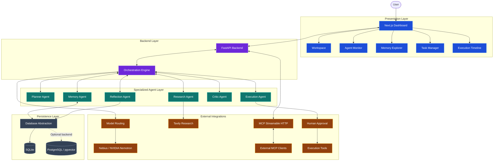
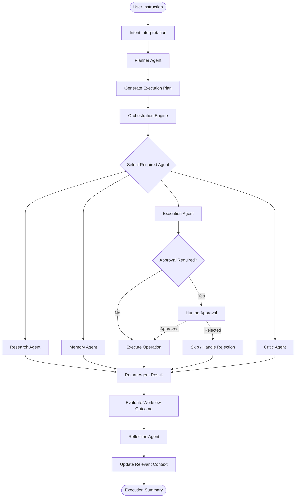
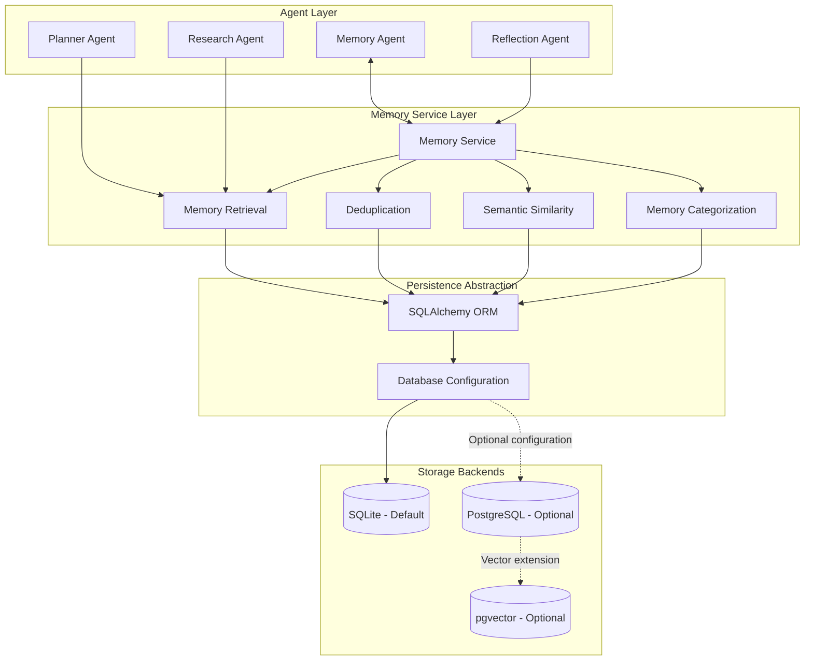
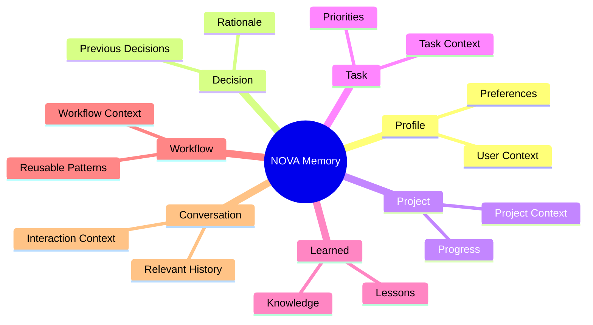
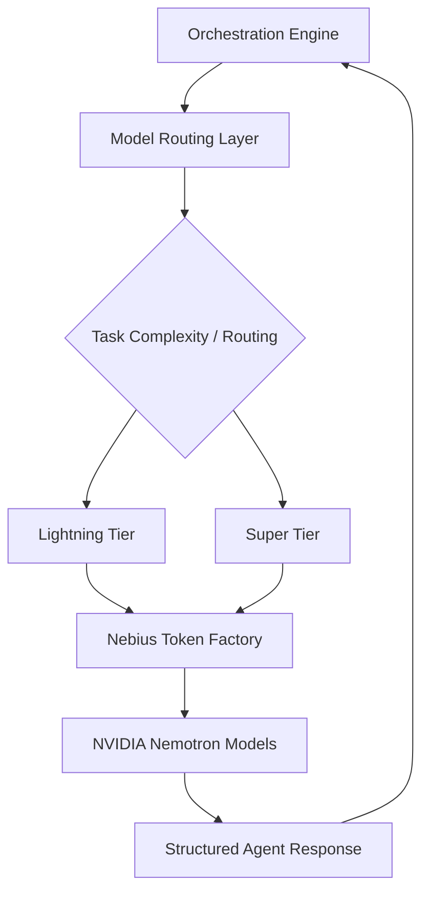
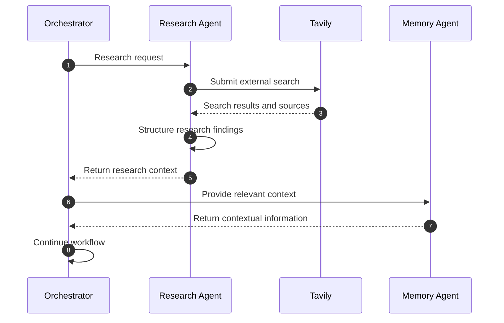

# NOVA — Personal AI Operating System

<p align="center">


</p>

<p align="center">
<strong>Think. Plan. Delegate. Execute. Remember.</strong>
<br/>
<em>An intelligent AI operator designed to transform natural-language instructions into coordinated, multi-step actions.</em>
</p>

<p align="center">
<a href="#-overview">Overview</a> •
<a href="#-key-capabilities">Capabilities</a> •
<a href="#-system-architecture">Architecture</a> •
<a href="#-technology-stack">Tech Stack</a> •
<a href="#-getting-started">Installation</a> •
<a href="#-documentation">Documentation</a>
</p>

<p align="center">


</p>

---

## ✦ Overview

**NOVA (Personal AI Operating System)** is a multi-agent AI operator designed to move beyond conventional conversational assistants.

Traditional AI assistants primarily respond to individual prompts. NOVA is designed to understand objectives, break them into actionable steps, coordinate specialized agents, interact with tools, maintain persistent contextual memory, and execute workflows with appropriate human oversight.

It brings together an orchestration engine, six specialized agents, a persistent memory layer, external research capabilities, model routing, and an interactive operations dashboard.

Rather than treating every interaction as an isolated conversation, NOVA aims to provide a continuous environment where information, decisions, projects, tasks, and workflows can work together.

> [!IMPORTANT]
> **The core idea behind NOVA:** An AI system should not simply tell you what needs to be done. It should be capable of planning the work, coordinating the right capabilities, executing approved actions, and learning from the outcomes.

### Why NOVA?

| Conventional AI Assistant | NOVA |
|---|---|
| Responds to individual prompts | Understands multi-step objectives |
| Primarily conversational | Plan-oriented and execution-focused |
| Limited contextual continuity | Persistent, categorized memory |
| Single-agent interaction | Six specialized agents |
| Limited workflow visibility | Observable execution timeline |
| Tool execution with limited oversight | Human-in-the-loop approval |
| Isolated interactions | Context-aware workflows |

---

## ✦ Key Capabilities

### 01. Multi-Agent Intelligence

NOVA follows a specialized multi-agent architecture in which individual agents handle distinct responsibilities while collaborating through a centralized orchestration layer.

| Agent | Primary Responsibility |
|---|---|
| 🧠 **Planner Agent** | Interprets objectives and decomposes them into actionable steps |
| 🔍 **Research Agent** | Retrieves external information and performs research |
| 🗂️ **Memory Agent** | Manages contextual memory and information retrieval |
| ⚙️ **Execution Agent** | Coordinates tool execution and approved operations |
| 🛡️ **Critic Agent** | Evaluates plans, outputs, and execution quality |
| 🔄 **Reflection Agent** | Reviews outcomes and captures useful improvements |

The agents work together rather than operating as six unrelated assistants.

### 02. Persistent Contextual Memory

NOVA incorporates a structured memory layer to retain useful information across interactions.

Memory is organized into seven categories:

| Memory Category | Purpose |
|---|---|
| **Profile** | User preferences and personal context |
| **Decision** | Previously established decisions |
| **Project** | Project-related context and progress |
| **Task** | Tasks, priorities, and associated information |
| **Learned** | Knowledge and lessons captured over time |
| **Workflow** | Reusable workflow context |
| **Conversation** | Relevant conversational history |

**Memory capabilities include:**
- Persistent memory storage.
- Context retrieval.
- Semantic similarity-based matching.
- Memory deduplication.
- Categorized memory management.
- Integration with agent workflows.

### 03. Intelligent Planning and Execution

NOVA transforms natural-language instructions into structured execution plans.

**The orchestration layer supports:**
- Intent interpretation.
- Task decomposition.
- Execution-step generation.
- Specialized agent coordination.
- Dependency-aware workflow execution.
- Execution status tracking.
- Approval-gated state-changing operations.
- Outcome evaluation and reflection.

### 04. Human-in-the-Loop (HITL)

Automation should not eliminate user control.

NOVA incorporates approval checkpoints for designated state-changing operations, separating planning from authorization and execution.

This provides a controlled execution model where users can review operations before allowing them to proceed.

**Key principles:**
- Explicit approval for designated operations.
- Controlled execution.
- Separation of planning and execution.
- Traceable workflow activity.

### 05. External Research and Source Attribution

The Research Agent integrates with Tavily to retrieve external information and provide research context to downstream workflows.

**Capabilities include:**
- External web research.
- Structured research results.
- Source attribution.
- Research-driven workflow context.

### 06. Intelligent Model Routing

NOVA integrates with Nebius Token Factory and NVIDIA Nemotron models through a configurable model-routing layer.

The design supports two inference tiers:

| Model Tier | Intended Usage | Model Identifier |
|---|---|---|
| **Lightning** | Lightweight and faster operations | `nvidia/nemotron-mini-4b-instruct` |
| **Super** | Complex reasoning and demanding tasks | `nvidia/llama-3.1-nemotron-70b-instruct` |

The routing architecture balances responsiveness, model capability, and task complexity.

### 07. Model Context Protocol (MCP)

NOVA exposes an MCP-compatible server using Streamable HTTP.

This provides a standardized integration interface for connecting compatible external clients and tools to NOVA's capabilities.

The MCP layer includes server configuration, session management, and tool connectivity.

### 08. Interactive Operations Dashboard

NOVA includes a Next.js dashboard designed to provide a centralized operational view of the system.

| Dashboard Module | Function |
|---|---|
| **Overview Dashboard** | High-level operational overview |
| **Workspace** | Primary interaction environment |
| **Agent Monitor** | Agent activity and execution visibility |
| **Memory Explorer** | Explore categorized contextual memory |
| **Task Manager** | View and manage tasks |
| **Research Panel** | Display research information |
| **Execution Timeline** | Follow workflow execution steps |

---

## ✦ System Architecture

NOVA follows a modular architecture that separates the frontend, backend API, orchestration engine, specialized agents, persistence, and external integrations.

### High-Level Architecture



### Architecture Principles

- **Modularity:** Specialized components have clearly defined responsibilities.
- **Separation of concerns:** Presentation, orchestration, persistence, and integrations remain distinct.
- **Extensibility:** Model providers and MCP-compatible integrations can be extended.
- **Observability:** Agent activity and workflow execution are exposed through the dashboard.
- **Human oversight:** Designated state-changing operations require approval.
- **Persistence:** Useful contextual information is retained across sessions.

### Agent Execution Lifecycle

A typical NOVA workflow follows a structured lifecycle:



### Execution Philosophy

NOVA separates the stages of understanding, planning, authorization, execution, and reflection.
This makes workflows easier to inspect, reason about, and control.

### Memory and Database Architecture

NOVA uses a persistence layer to retain tasks, preferences, and contextual memory.
SQLite is the default database configuration. PostgreSQL with pgvector is included as an optional extended persistence direction.

#### Logical Persistence Architecture



#### Logical Memory Model

The following diagram illustrates NOVA's memory classification. It represents logical memory categories, not a physical database schema.



#### Persistence Design

| Component | Purpose |
|---|---|
| **SQLAlchemy** | Database interaction and ORM abstraction |
| **SQLite** | Default local persistence |
| **PostgreSQL** | Optional extended database backend |
| **pgvector** | Optional vector storage capability |
| **Memory Service** | Memory creation, retrieval, and management |
| **Database Configuration** | Centralized persistence configuration |

> [!NOTE]
> PostgreSQL/pgvector support is an optional architectural direction. Its live deployment and end-to-end operation should be validated separately before being treated as a verified production capability.

### Research and Model Integration

NOVA separates external intelligence providers from the orchestration layer.

#### Model Integration



#### Research Integration



---

## ✦ Technology Stack

NOVA combines a modern web frontend, Python backend, multi-agent orchestration, persistent storage, and external AI integrations.

| Layer | Technologies |
|---|---|
| **Frontend Framework** | Next.js 14 |
| **Frontend Language** | TypeScript |
| **Styling** | Tailwind CSS |
| **UI Icons** | Lucide React |
| **Animations** | Framer Motion |
| **Backend Framework** | Python, FastAPI |
| **API Documentation** | FastAPI / OpenAPI |
| **AI Models** | Nebius Token Factory, NVIDIA Nemotron |
| **Research Integration** | Tavily |
| **ORM** | SQLAlchemy |
| **Default Database** | SQLite |
| **Optional Database** | PostgreSQL, pgvector |
| **Agent Connectivity** | Model Context Protocol |
| **MCP Transport** | Streamable HTTP |
| **Testing** | Pytest |
| **Package Management** | pip, npm |

### Technology Highlights

<p>


</p>

---

## ✦ Project Structure

```text
NOVA-AI-OPERATOR/
├── backend/
│   ├── app/
│   │   ├── agents/
│   │   │   ├── __init__.py
│   │   │   ├── base.py
│   │   │   ├── planner_agent.py
│   │   │   ├── research_agent.py
│   │   │   ├── memory_agent.py
│   │   │   ├── execution_agent.py
│   │   │   ├── critic_agent.py
│   │   │   └── reflection_agent.py
│   │   ├── core/
│   │   │   └── nebius_client.py
│   │   ├── models/
│   │   │   ├── memory.py
│   │   │   ├── preference.py
│   │   │   └── task.py
│   │   ├── schemas/
│   │   │   ├── memory.py
│   │   │   ├── orchestration.py
│   │   │   ├── preference.py
│   │   │   ├── research.py
│   │   │   └── task.py
│   │   ├── services/
│   │   │   ├── memory_service.py
│   │   │   ├── orchestration_service.py
│   │   │   ├── preference_service.py
│   │   │   ├── task_service.py
│   │   │   └── tavily_service.py
│   │   ├── tools/
│   │   │   └── mcp_server.py
│   │   ├── config.py
│   │   ├── database.py
│   │   └── main.py
│   ├── tests/
│   │   ├── conftest.py
│   │   ├── test_agents.py
│   │   ├── test_health.py
│   │   ├── test_mcp.py
│   │   ├── test_memory.py
│   │   ├── test_nebius.py
│   │   ├── test_orchestration.py
│   │   ├── test_tasks.py
│   │   └── test_tavily.py
│   ├── requirements.txt
│   └── .env.example
├── frontend/
│   ├── legacy/
│   │   ├── app.js
│   │   ├── index.html
│   │   └── style.css
│   ├── src/
│   │   ├── app/
│   │   │   ├── globals.css
│   │   │   ├── layout.tsx
│   │   │   └── page.tsx
│   │   └── components/
│   │       ├── AgentMonitor.tsx
│   │       ├── DashboardOverview.tsx
│   │       ├── ExecutionTimeline.tsx
│   │       ├── MemoryExplorer.tsx
│   │       ├── ResearchPanel.tsx
│   │       ├── Sidebar.tsx
│   │       ├── TaskManager.tsx
│   │       └── Workspace.tsx
│   ├── next-env.d.ts
│   ├── next.config.js
│   ├── package.json
│   ├── package-lock.json
│   └── tailwind.config.js
├── scripts/
│   ├── verify_mcp_client.py
│   ├── verify_milestone_l1.py
│   ├── verify_nebius_live.py
│   ├── verify_production_readiness.py
│   └── verify_tavily_live.py
├── .env.example
├── .gitignore
├── API_CONTRACT.md
├── ARCHITECTURE.md
├── CONTRIBUTING.md
├── FINAL_RELEASE_CHECKLIST.md
├── LICENSE
├── PRODUCTION_READINESS_REPORT.md
├── README.md
├── SETUP.md
└── requirements.txt
```

---

## ✦ Getting Started

Follow the steps below to run NOVA locally.

### Prerequisites

Make sure the following are installed:
- Python 3.10+
- Node.js (v18+) and npm
- Git
- API credentials for the external integrations you intend to enable (Nebius, Tavily)

### 1. Clone the Repository

```bash
git clone https://github.com/lakshya0101/Nova-AI-Operator.git
cd Nova-AI-Operator
```

### 2. Set Up the Backend

Navigate to the backend directory:
```bash
cd backend
```

Create a virtual environment:
```bash
python -m venv .venv
```

Activate the environment:

**Windows PowerShell:**
```powershell
.venv\Scripts\Activate.ps1
```

**Linux / macOS:**
```bash
source .venv/bin/activate
```

Install the dependencies:
```bash
pip install -r requirements.txt
```

### 3. Configure Environment Variables

Create a local environment file:

**Windows PowerShell:**
```powershell
Copy-Item .env.example .env
```

**Linux / macOS:**
```bash
cp .env.example .env
```

Configure the relevant variables in `.env`:
```ini
# NOVA Configuration
LOG_LEVEL=INFO

# Persistence
DATABASE_URL=sqlite:///./nova.db

# Nebius Token Factory
NEBIUS_API_KEY=
NEBIUS_BASE_URL=https://api.studio.nebius.ai/v1

# Model Configuration
NEBIUS_MODEL_LIGHTNING=nvidia/nemotron-mini-4b-instruct
NEBIUS_MODEL_SUPER=nvidia/llama-3.1-nemotron-70b-instruct

# External Research
TAVILY_API_KEY=

# MCP Configuration
MCP_SERVER_NAME=nova
MCP_SERVER_VERSION=2.0.0
MCP_MOUNT_PATH=/mcp
```

> [!WARNING]
> Keep your actual API keys in your local `.env` file. Never commit credentials, tokens, or other secrets to the repository.

### 4. Start the Backend Server

From the backend directory:
```bash
uvicorn app.main:app --reload --port 8000
```

- **Backend API:** `http://localhost:8000`
- **Interactive Documentation:** `http://localhost:8000/docs`

### 5. Start the Frontend

Open another terminal and navigate to the frontend directory:
```bash
cd frontend
npm install
npm run dev
```

- **Frontend Dashboard:** `http://localhost:3000`

### 6. Access NOVA

Once both services are running, open your browser:
```text
http://localhost:3000
```

The NOVA operational dashboard should now be available locally. For additional configuration details, refer to [SETUP.md](SETUP.md).

---

## ✦ Testing and Validation

NOVA includes automated tests and verification scripts covering its core backend functionality.

### Test Coverage Areas

| Area | Validation Focus |
|---|---|
| **Agents** | Agent behavior and coordination |
| **Memory** | Memory creation, retrieval, and management |
| **Orchestration** | Workflow planning and execution |
| **Approval** | Approval enforcement and security checkpoints |
| **MCP** | MCP server functionality and tool registry |
| **Tasks** | Task management operations |
| **Health** | Backend health and API behavior |
| **Integrations** | Model and research integration interfaces |

### Run Backend Tests

From the repository root or backend directory:
```bash
pytest -v
```

### Additional Verification Scripts

The `scripts/` directory contains dedicated verification utilities:

| Script | Purpose |
|---|---|
| `verify_mcp_client.py` | MCP client verification |
| `verify_milestone_l1.py` | Milestone verification |
| `verify_nebius_live.py` | Live Nebius integration verification |
| `verify_production_readiness.py` | Production-readiness checks |
| `verify_tavily_live.py` | Live Tavily integration verification |

> [!IMPORTANT]
> Passing automated tests and local simulations does not establish that every external service is working live. Nebius inference, Tavily research, and optional PostgreSQL/pgvector functionality require their respective credentials, configuration, and separate integration testing.

---

## ✦ Security and Execution Control

NOVA is designed around controlled execution rather than unrestricted automation.

**Key considerations include:**
- Environment-based configuration for external credentials.
- Approval checkpoints for designated state-changing actions.
- Separation of planning and execution.
- Modular integration boundaries.
- Observable workflow execution.
- Persistent operational context.

As the system evolves, additional permission controls, deployment safeguards, and operational security measures will continue to be refined.

---

## ✦ Roadmap

NOVA is being developed toward a more capable, reliable, and extensible personal AI operating environment.


### Planned Enhancements

| Area | Future Direction |
|---|---|
| **Agent Intelligence** | More adaptive planning and agent coordination |
| **Memory** | Improved contextual retrieval and memory refinement |
| **Model Routing** | Additional providers and intelligent model selection |
| **Automation** | Broader real-world workflow execution |
| **Integrations** | Expanded MCP tools and external services |
| **Security** | More granular permission management |
| **Observability** | Richer traces, metrics, and system-level monitoring |
| **Deployment** | Production-oriented deployment and scaling |

---

## ✦ Documentation

Explore the technical documentation included in the repository:

| Document | Description |
|---|---|
| [Architecture](ARCHITECTURE.md) | System design and architectural components |
| [Setup Guide](SETUP.md) | Local installation and configuration |
| [API Contract](API_CONTRACT.md) | Backend API contracts |
| [Production Readiness Report](PRODUCTION_READINESS_REPORT.md) | Implementation and readiness assessment |
| [Final Release Checklist](FINAL_RELEASE_CHECKLIST.md) | Release verification checklist |
| [Contributing Guidelines](CONTRIBUTING.md) | Contribution workflow and guidelines |
| [License](LICENSE) | Project licensing information |

---

## ✦ Contributors

NOVA is developed collaboratively:

| Contributor | Contribution |
|---|---|
| **Lakshya Dogra** | Project architecture, AI orchestration, backend engineering, and system integration |
| **Smriti Verma** | Project collaboration and development |

---

## ✦ Contributing

Contributions, ideas, and improvements are welcome. If you would like to contribute:

1. Fork the repository.
2. Create a feature branch (`git checkout -b feature/amazing-feature`).
3. Implement your changes.
4. Add or update relevant tests.
5. Submit a pull request with a clear description.

Please review [CONTRIBUTING.md](CONTRIBUTING.md) before submitting changes.

---

## ✦ License

This project is distributed under the Apache License 2.0. Please refer to [LICENSE](LICENSE) for the applicable terms.

---

<p align="center">

</p>

<h3 align="center">NOVA — From Conversations to Coordinated Action.</h3>

<p align="center">
<em>Building a more capable, contextual, and controllable personal AI operating system.</em>
</p>

<p align="center">
<a href="https://github.com/lakshya0101/Nova-AI-Operator">Explore NOVA on GitHub</a>
</p>
