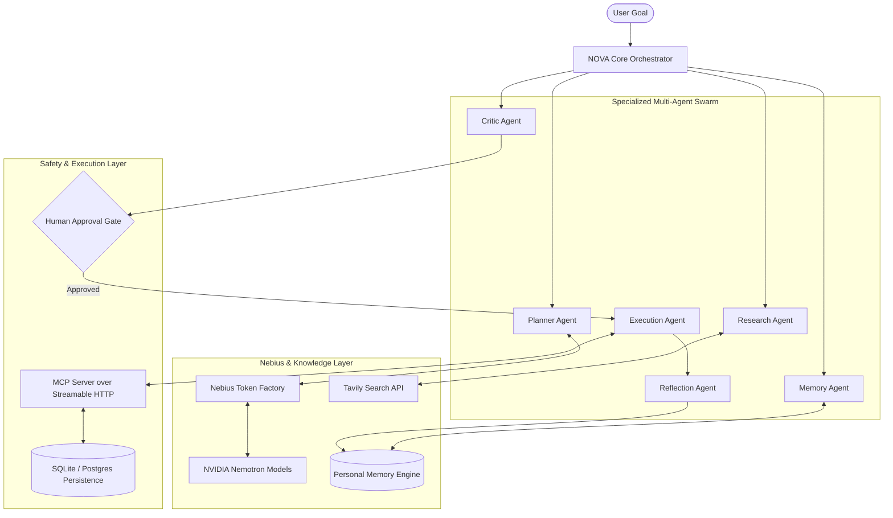

# NOVA – Personal AI Operating System

<div align="center">

**Think. Remember. Orchestrate. Execute.**

*An autonomous personal digital intelligence built for the **Nebius &times; NVIDIA Global AI Hackathon 2026**.*

[](https://www.python.org/)
[](https://fastapi.tiangolo.com/)
[](https://nextjs.org/)
[](https://nebius.com/token-factory)
[](https://www.nvidia.com/)
[](https://modelcontextprotocol.io/)
[]()

</div>

---

## 1. Product Vision

**NOVA** transforms conversational AI from a passive chatbot into an active, autonomous **Personal AI Operating System**. It understands high-level goals, remembers personal context across sessions, strategically plans multi-step workflows, delegates tasks across specialized agents, executes verifiable actions through Model Context Protocol (MCP) tools, and enforces strict human-in-the-loop security checkpoints before mutating external state.

```
       [ Think ]       -->  Decompose natural-language goals into dependency-aware plans
      [ Remember ]     -->  Recall personal context & rules via semantic vector search
     [ Orchestrate ]   -->  Delegate tasks across a specialized 6-agent swarm
      [ Execute ]      -->  Safely invoke actions via MCP tools with human approval
```

---

## 2. Key Capabilities

- **Dual-Tier NVIDIA Nemotron Intelligence via Nebius Token Factory:**
  - **Nemotron Lightning (`nvidia/nemotron-mini-4b-instruct`)**: Routine reasoning, fast critic analysis, and post-execution reflections.
  - **Nemotron Super (`nvidia/llama-3.1-nemotron-70b-instruct`)**: Strategic planning, complex goal decomposition, and multi-agent orchestration.
- **Specialized 6-Agent Swarm:**
  1. **Planner Agent**: Analyzes objectives, handles dependency mapping, and crafts actionable plans.
  2. **Research Agent**: Queries live web indexes via Tavily, preserving verified source URLs and evidence snippets.
  3. **Memory Agent**: Retrieves personal preferences and historical context before execution begins.
  4. **Execution Agent**: Safely executes validated tool calls over the official Model Context Protocol (MCP).
  5. **Critic Agent**: Validates plan feasibility and enforces approval gating on state mutations.
  6. **Reflection Agent**: Evaluates finished workflows, measures efficiency, and updates memory.
- **Persistent Personal Memory Engine:**
  - Semantic vector search with normalized cosine similarity across 7 memory categories (Profile, Decisions, Projects, Tasks, Learned Context, Workflows, Conversations).
  - Intelligent deduplication and update mechanics.
- **Human-in-the-Loop Security Architecture:**
  - Read-only tools (`get_tasks`, `get_user_preferences`) run safely without risk.
  - State-changing tools (`create_task`, `update_task_status`) require explicit human approval (`approve=true`) or are held in preview (`dry_run=true`).
- **Futuristic AI Command Center (Next.js):**
  - Dark-first cyber aesthetic (deep midnight navy, cyan accents).
  - Live AI Workspace, Agent Monitor, Memory Explorer, Task Manager, Web Research panel, and Execution Timeline.

---

## 3. Architecture



---

## 4. Technology Stack

| Layer | Technology | Details |
|---|---|---|
| **AI Inference** | **Nebius Token Factory** | OpenAI-compatible high-throughput inference platform |
| **Foundation Models**| **NVIDIA Nemotron** | `nemotron-mini-4b-instruct` & `llama-3.1-nemotron-70b-instruct` |
| **Web Intelligence** | **Tavily** | Real-time search engine optimized for AI agents |
| **Tool Protocol** | **Model Context Protocol (MCP)**| Streamable HTTP session transport with DNS rebinding security |
| **Backend API** | **FastAPI & Pydantic v2** | High-performance Python backend with type-safe schema validation |
| **Persistence** | **SQLAlchemy 2.0 & SQLite / pgvector** | Structured task persistence and dense vector memory indexing |
| **Frontend UI** | **Next.js 14, TypeScript, Tailwind CSS** | Futuristic dark-first AI command center with Lucide Icons |

---

## 5. Primary Benchmark Demonstration Workflow

**User Instruction:**
> *"Organize my evening. Prioritize my unfinished tasks, research the latest AI agent developments, and leave time for interview preparation."*

### Step-by-Step NOVA Execution:
1. **Context Retrieval (Memory Agent):** Recalls user rule: *Always dedicate at least 45 minutes to technical interview preparation before evening leisure.*
2. **Web Intelligence (Research Agent):** Uses Tavily to query current AI engineer interview focus areas (autonomous multi-agent systems, human-in-the-loop safety, pgvector).
3. **Strategic Planning (Planner Agent):** NVIDIA Nemotron Super constructs an ordered 3-step workflow.
4. **Safety Gating (Critic Agent):** Flags task creation as a state mutation requiring explicit human confirmation.
5. **Human Approval:** User reviews the proposal in the AI Workspace and clicks **Execute Workflow (Approved)**.
6. **Action Execution (Execution Agent):** Invokes `create_task` over MCP, persisting the interview preparation milestone.
7. **Continuous Learning (Reflection Agent):** Records the successful run into long-term memory for future context retrieval.

---

## 6. Quick Start

### 6.1 Clone & Setup Environment
```bash
git clone https://github.com/lakshya0101/Nova-AI-Operator.git
cd Nova-AI-Operator

# Virtual environment setup
python -m venv .venv
.\.venv\Scripts\activate      # Windows
# source .venv/bin/activate   # Linux/macOS

pip install -r requirements.txt
cp .env.example .env
```

### 6.2 Run Automated Tests
```bash
pytest -v
```
*(All 36 unit and integration tests run and pass out-of-the-box.)*

### 6.3 Start Backend Server
```bash
uvicorn backend.app.main:app --host 127.0.0.1 --port 8000 --reload
```
- API Docs: `http://127.0.0.1:8000/docs`
- MCP Streamable HTTP endpoint: `http://127.0.0.1:8000/mcp`

### 6.4 Start Frontend Command Center
```bash
cd frontend
npm install
npm run dev
```
Open `http://localhost:3000` to enter the NOVA Command Center.

---

## 7. Status & Implementation Matrix

| Capability | Status | Implemented Components |
|---|---|---|
| **NVIDIA Nemotron Integration** | ✅ Complete | Dual-tier routing (Lightning/Super), latency/token tracking, retry logic |
| **Nebius Token Factory** | ✅ Complete | OpenAI-compatible HTTP client with live key support & offline simulator |
| **Specialized Multi-Agent Swarm** | ✅ Complete | Planner, Research, Memory, Execution, Critic, and Reflection agents |
| **Personal Memory Engine** | ✅ Complete | 7 memory categories, dense vector cosine similarity, CRUD endpoints |
| **Tavily Web Research** | ✅ Complete | Real web search, citation extraction, source link preservation |
| **MCP Tool Integration** | ✅ Complete | Streamable HTTP endpoint, `get_tasks`, `create_task`, `update_task_status` |
| **Human-in-the-Loop Safety** | ✅ Complete | Dry-run previewing, approval verification, and mutation gating |
| **Next.js Command Center** | ✅ Complete | Futuristic UI, Workspace, Agent Monitor, Memory Explorer, Timeline |
| **Automated Test Suite** | ✅ Complete | 36 automated pytest tests (100% passing) |

---

## 8. License

This project is licensed under the Apache License 2.0. See [LICENSE](LICENSE) for details.
